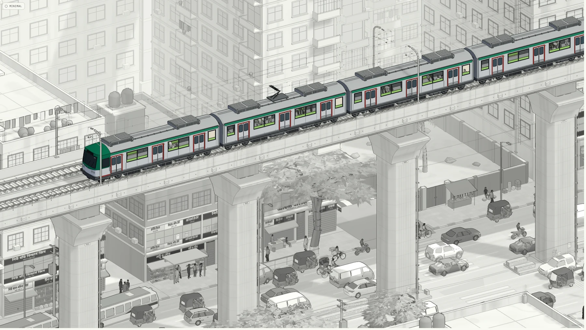
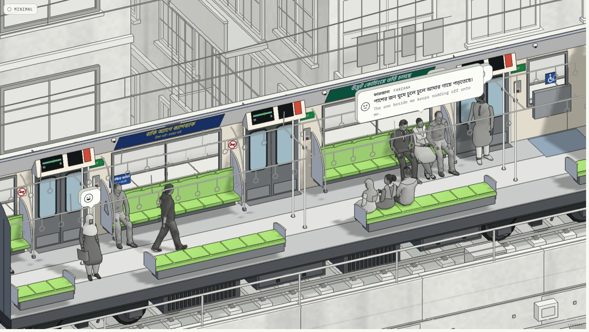

<p align="center">
  <a href="https://headway-dhaka.vercel.app"></a>
</p>

<h1 align="center">Headway</h1>

<p align="center">
  An endless ride on Dhaka Metro Line 6. The train never stops.<br />
  Open a coach and read what the people inside are thinking.
</p>

<p align="center">
  <a href="https://headway-dhaka.vercel.app"><b>Ride it at headway-dhaka.vercel.app</b></a>
</p>

---

A six-car train crosses a Dhaka that is generated as it goes and never ends. The city is drawn in grey, people included. Only the train has colour.

There are no stations. What you visit instead is the inside of people's heads.

<p align="center">
  
</p>

## What you can do

| | |
|---|---|
| **Hover** a coach | See its name. Each is a joke in everyday Dhaka talk. |
| **Click** a coach | It opens, and the thoughts come up one by one. |
| **Click** a passenger | Read that one's mind. |
| **Click** empty floor | Step back out. |
| **Wheel** or pinch | Zoom. |
| **Drag** | Turn the camera a little. |
| **Minimal**, top left | The same city with most of it dissolved into paper. |

Leave it alone and it tours itself.

## The six coaches

| Coach | Who rides it |
|---|---|
| **Elbow-free zone** কনুইমুক্ত এলাকা | The first coach. |
| **No room for a sesame seed** তিল ধারণের ঠাঁই নেই | Everyone, at once, on their feet. |
| **The seat-grabbing movement** সিট দখল আন্দোলন | The seated, and those standing over them, waiting. |
| **Ministry of sleep** ঘুম মন্ত্রণালয় | People who were up too late. |
| **Almost there, I swear** এই তো, চলে আসছি | People who are not almost there. |
| **Basically Singapore** পুরাই সিঙ্গাপুর | First-timers. |

The operator has a cabin, and thoughts, of their own.

## The thoughts are true

Every line is something you would only think on the metro, right now: the smell of the man beside you, the seat about to come free, the headphones left at home. They are written in the Bangla that Dhaka actually speaks, with English underneath.

A line about someone is only thought by a passenger who can see that someone. "The apu beside me has fallen asleep on my shoulder" needs a woman asleep on the next seat, and when it comes up, the thinker turns to look at her. Sleepers sink onto their neighbours and start awake. People on phones glance up to see which station it is. Everyone looks at whoever walks past.

## How it is made

TypeScript and three.js, with no game engine.

- **The city** is built in web workers, a block at a time, from a seed: buildings, shopfronts with Bangla signs, walled plots, trees, a road with traffic that follows, changes lanes and stops at signals.
- **The drawing** is a colour and geometry pass, then ink lines found from depth and normals, then haze. From far off the city goes as light as pencil and the train keeps its ink.
- **The people** are baked from rigged models into a few poses each, then cut at the neck so their heads can turn.
- **The sound** is one audio graph that follows the camera: the rails outside, the hum inside.

`CLAUDE.md` is the map of the code.

## Run it

```sh
pnpm install
pnpm dev        # http://127.0.0.1:5180
pnpm test
pnpm build
```

## Credits

The people come from Microsoft's Rocketbox avatar library. The vehicles, mosques and tower blocks are Creative Commons models by the artists named in [`public/credits.txt`](public/credits.txt), simplified and redrawn in grey.

Made by [Nadid Azwad](https://github.com/nadidazwad).
